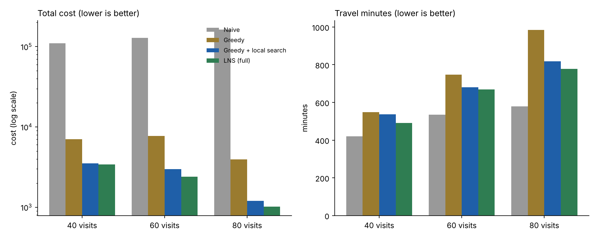
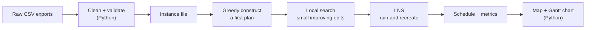
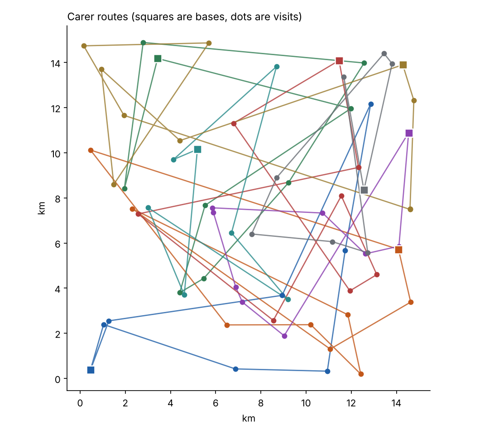
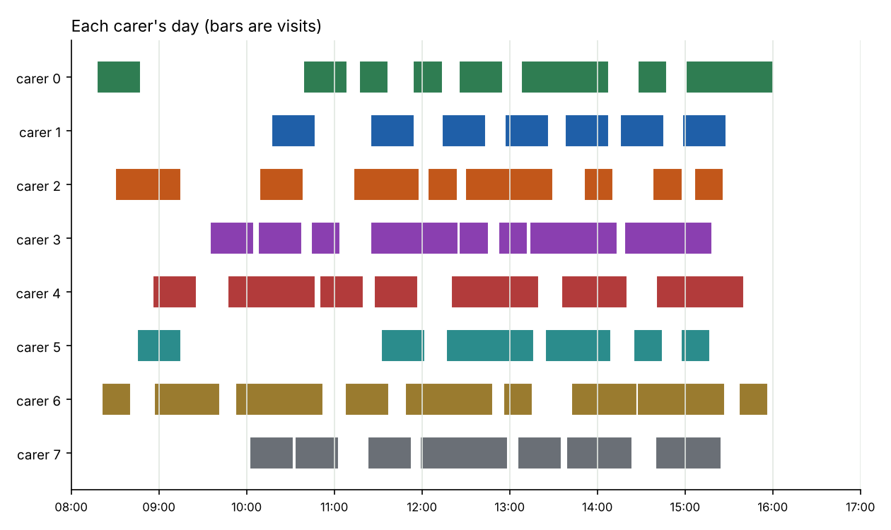

# CareRoute

**Plan a day of home-care visits: decide which carer sees each client, and in
what order, so that skills match, appointment times are kept, nobody is
overloaded, and travel is low.** The solver is written in C++; the data cleaning
and the charts are in Python.



This is the problem a home-care provider solves every single day, usually by hand
on a whiteboard. CareRoute is a small, honest, end-to-end version of an automated
planner for it: take messy scheduling data, clean and check it, build a good
plan, and show it.

## The problem, in plain words

Every morning a provider has a list of **visits** (one per client appointment)
and a team of **carers**. Each visit needs a certain skill, takes a certain time,
and should happen inside a time window (for example "between 9:00 and 10:30").
Each carer has a skill set, a shift, and a limit on how long they can work. Some
clients want the same carer they usually have.

We have to give every visit to a carer and put each carer's visits in an order,
so the day works. This is known in operational research as the **Home Health
Care Routing and Scheduling Problem**, a cousin of the vehicle routing problem.
It is hard: there are far too many possible plans to try them all, so we use
heuristics, methods that find a very good plan quickly without promising the
perfect one.

## How it works



## What makes a plan good

Most rules are **soft**: breaking one is allowed but adds to a cost, and the
solver tries to make the total cost small. This is how real planners think, and
it lets us trade one goal against another just by changing the weights. The cost
adds up:

- travel time,
- a heavy penalty for any visit left uncovered,
- lateness (minutes a visit starts after its window),
- overtime (minutes a carer works beyond their allowed time),
- continuity (a client not getting their preferred carer),
- imbalance (the gap between the busiest and quietest carer).

The one **hard** rule is skills: a carer is never given a visit they are not
trained for. All of this lives in `src/careroute/solution.cpp`, and the weights
are in one place so they are easy to change.

## The methods

CareRoute builds a plan in three steps, each better than the last.

1. **Greedy construction** (`construct.cpp`). Take the visits with the tightest
   time windows first, and drop each into the single cheapest legal spot across
   all carers. Fast, and a decent start.
2. **Local search** (`localsearch.cpp`). Keep making small edits that lower the
   cost until none help: move a visit elsewhere (relocate), exchange two visits
   between carers (swap), or reverse a run of visits in one carer's day. This
   reaches a "local best".
3. **Large Neighbourhood Search** (`lns.cpp`). To escape that local best, repeat:
   tear out a handful of visits (ruin) and greedily put them back (recreate).
   Keep a better plan always, and a slightly worse one now and then, with a
   chance that shrinks as the search cools (simulated annealing). This is the
   method that finds the best plans.

A deliberately simple **naive** baseline (send each visit to the nearest skilled
carer) is included so the gains can be measured.

## Results

Averaged over several random instances of each size (lower cost is better; every
visit was covered in all cases):

| Visits | Naive | Greedy | Greedy + local search | LNS |
|---|---|---|---|---|
| 40 | 109,638 | 7,044 | 3,529 | **3,395** |
| 60 | 129,007 | 7,733 | 2,995 | **2,412** |
| 80 | 163,400 | 3,948 | 1,197 | **1,016** |

**The interesting bit:** the naive baseline actually has the *lowest travel* of
all. It still has by far the worst cost, because by chasing short trips it ignores
the time windows and overloads carers, so it racks up huge lateness and overtime
penalties. LNS accepts a little more travel to get a plan that actually works.
This is the whole point of optimising the right objective rather than the obvious
one.

Here is one 60-visit plan LNS produced:





The routes cross because visits are tied to clock times, not just location; two
houses next door to each other can need visits hours apart. The Gantt chart shows
the days come out well balanced across the team.

## Cleaning real-world data

Before any of this runs, the data has to be made correct. Real exports are messy,
so `careroute_data/validate.py` ingests raw CSVs and:

- reads times written either as `09:30` or as minutes,
- drops rows with missing fields, bad ids or impossible shifts,
- fixes time windows that are the wrong way round and clears preferred carers who
  do not exist,
- flags visits that need a skill no carer holds,
- writes a clean instance and a plain-English report of every change.

```
carers: 10 read, 8 kept
visits: 63 read, 60 kept
issues: 5 errors, 3 fixed, 1 warnings
[fixed] visit 3: time window was reversed, swapped
[warn ] visit 1000: needs skill 9 that no carer holds (will be left unassigned)
```

## Run it

```bash
# build the C++ solver and run the tests
cmake -S . -B build && cmake --build build
ctest --test-dir build

# make an instance and solve it three ways
python3 scripts/generate_instance.py --carers 8 --visits 60 --out data/town_60.txt
./build/careroute data/town_60.txt --method greedy
./build/careroute data/town_60.txt --method ls
./build/careroute data/town_60.txt --method lns --out reports/solution.txt

# clean messy data, draw a plan, compare the methods
python3 scripts/make_messy_csv.py --instance data/town_60.txt --out data/raw
python3 scripts/clean_data.py --carers data/raw/carers.csv --visits data/raw/visits.csv
python3 scripts/visualise.py --instance data/town_60.txt --solution reports/solution.txt
python3 scripts/run_eval.py
```

Changing the trade-offs is one flag, for example keep clients with their usual
carer more strongly:

```bash
./build/careroute data/town_60.txt --method lns --continuity 200
```

## Project layout

```
src/careroute/
  model.{hpp,cpp}        carers, visits, instances, travel times
  solution.{hpp,cpp}     a plan, the timing of a route, and the cost
  construct.{hpp,cpp}    greedy insertion, and the naive baseline
  localsearch.{hpp,cpp}  relocate, swap and reverse edits
  lns.{hpp,cpp}          ruin-and-recreate search
  io.{hpp,cpp}           read instances, write plans
src/main.cpp             the command-line runner
tests/                   unit tests (no external library)
careroute_data/          Python: data cleaning and validation, file readers
scripts/                 generate, clean, visualise, evaluate
```

## Honest limits

- The data is synthetic. The real test is on a provider's own data, which is
  messier and has rules this model does not yet have.
- Travel is straight-line distance over a speed. A real build would use road
  travel times; that is one function to swap out (`model.cpp`).
- One day is planned at a time. Rotas over a week, and fairness across days, are
  a natural next step.
- The weights that balance the goals should be set with the provider, not chosen
  in code.

Licence: MIT. Author: Jasper Chinedu Nwangere.
